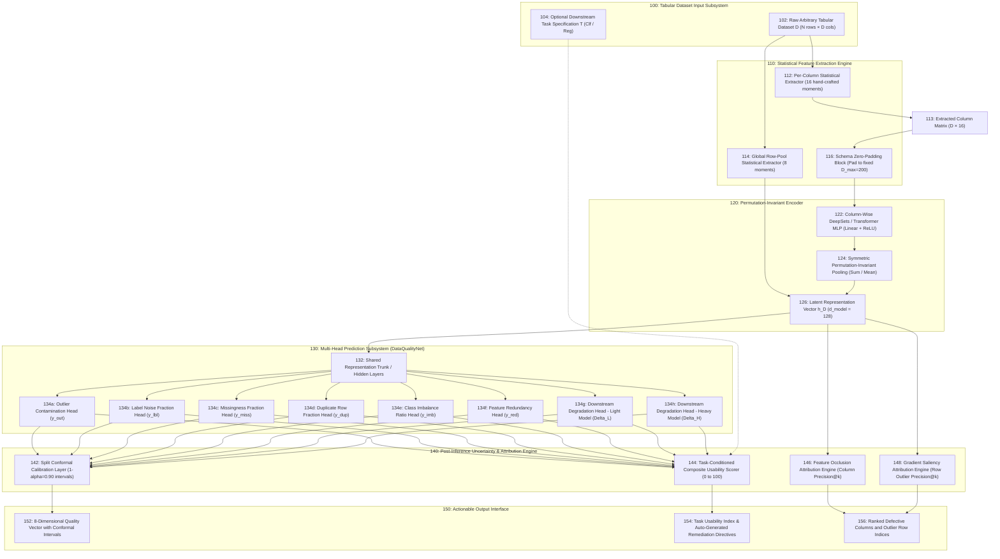
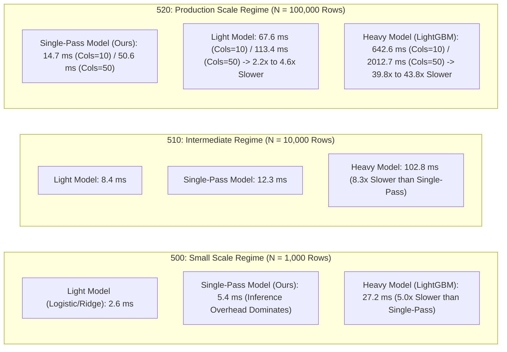
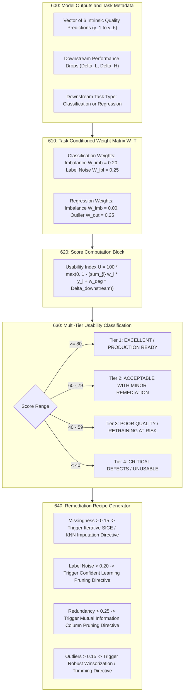

# PATENT DRAWINGS AND FIGURE DESCRIPTIONS
## Application for Patent under the Indian Patents Act, 1970
### Title: SYSTEM AND METHOD FOR SINGLE-PASS QUALITY ASSESSMENT AND DOWNSTREAM PERFORMANCE ESTIMATION OF TABULAR DATASETS USING PERMUTATION-INVARIANT ENCODERS

---

## FIG. 1: OVERALL SYSTEM ARCHITECTURE FOR SINGLE-PASS TABULAR ASSESSMENT

### Reference Numerals for FIG. 1:
- **100**: Tabular Dataset Input Subsystem
- **102**: Raw arbitrary tabular dataset $D \in \mathbb{R}^{N \times D}$
- **104**: Downstream task identifier input (classification or regression)
- **110**: Statistical Feature Extraction Engine
- **112**: Column-wise moments extractor computing 16 statistical features per feature column
- **113**: Raw column representation matrix of size $D \times 16$
- **114**: Global row-pool moments extractor computing 8 statistical aggregate features
- **116**: Fixed dimension zero-padding module to normalize varying column counts up to $D_{\max} = 200$
- **120**: Permutation-Invariant Encoder
- **122**: Column-wise non-linear feedforward mapping block
- **124**: Symmetric aggregation operator (sum/mean pooling) ensuring column permutation invariance
- **126**: Global dataset latent embedding vector $h_D \in \mathbb{R}^{128}$
- **130**: Multi-Head Prediction Subsystem (`DataQualityNet`)
- **132**: Shared latent representation trunk
- **134a**: Outlier contamination prediction head
- **134b**: Label noise fraction prediction head
- **134c**: Missingness fraction prediction head
- **134d**: Duplicate row fraction prediction head
- **134e**: Class imbalance ratio prediction head
- **134f**: Feature redundancy prediction head
- **134g**: Downstream degradation head for linear/light models ($\Delta L$)
- **134h**: Downstream degradation head for non-linear/gradient-boosted models ($\Delta H$)
- **140**: Post-Inference Uncertainty & Attribution Engine
- **142**: Split conformal prediction calibration layer providing non-parametric coverage bounds
- **144**: Task-conditioned composite usability scoring module mapping predictions to a $[0, 100]$ score
- **146**: Feature occlusion attribution module for column-level fault ranking
- **148**: Gradient saliency backpropagation module for row-level fault identification
- **150**: Diagnostic Output Interface
- **152**: Simultaneous multi-attribute vector with conformal confidence intervals
- **154**: Composite usability grade and targeted remediation recipes
- **156**: Ranked anomaly alerts identifying top defective columns and outlier sample indices

---

## FIG. 2: FLOWCHART OF THE SINGLE-PASS ASSESSMENT PROCESS

```mermaid
flowchart TD
    S200["200: Start: Ingest Tabular Dataset D of N rows × D columns"] --> S202
    S202["202: Validate Schema and Data Types (Impute NaNs for Stat Calculations)"] --> S204
    S204["204: Compute 16 Local Statistical Moments per Column"] --> S206
    S206["206: Compute 8 Global Aggregate Moments across Entire Dataset Matrix"] --> S208
    S208["208: Zero-Pad Column Statistics Matrix to Maximum Dimension D_max = 200"] --> S210
    S210["210: Transform Padded Column Vectors via Permutation-Invariant DeepSets Encoder"] --> S212
    S212["212: Concatenate Symmetric Column Representation with Global Row Moments"] --> S214
    S214["214: Execute Single Feedforward Pass through 8 Specialized Output Heads"] --> S216
    S216["216: Retrieve Pre-Calibrated Non-Conformity Quantiles (1 - alpha = 0.90)"] --> S218
    S218["218: Construct Validated Conformal Prediction Intervals for All 8 Estimates"] --> S220
    S220["220: Calculate Composite Usability Score (0 to 100) via Task-Conditioned Loss Weights"] --> S222
    S222{"222: Is Fault Attribution Requested by User / Triggered by Low Usability?"}
    S222 -- Yes --> S224
    S222 -- No --> S228
    S224["224: Execute Column Occlusion Masking to Compute Column Attribution Precision@k"] --> S226
    S226["226: Compute Saliency Gradients with Respect to Rows to Rank Outlier Samples"] --> S228
    S228["228: Generate Diagnostic Report with Metrics, Bounds, Scores, and Remediation Tips"] --> S230
    S230["230: End: Output Emitted to Downstream Pipeline / User Interface in Single Pass"]
```

### Reference Numerals for FIG. 2:
- **200**: Dataset ingestion entry step
- **202**: Schema validation and preprocessing step
- **204**: Extraction of per-column distribution moments
- **206**: Extraction of global dataset-level aggregates
- **208**: Canonical zero-padding step up to $D_{\max}$
- **210**: Permutation-invariant set encoding step
- **212**: Fusion of column-pooled embeddings with global row statistics
- **214**: Simultaneous multi-head forward evaluation step
- **216**: Conformal non-conformity calibration lookup step
- **218**: Conformal uncertainty interval assignment step
- **220**: Dynamic composite usability index calculation step
- **222**: Decision branching for granular attribution execution
- **224**: Column occlusion permutation evaluation step
- **226**: Row-level gradient backpropagation attribution step
- **228**: Diagnostic report generation step
- **230**: Output delivery step

---

## FIG. 3: PERMUTATION-INVARIANT ENCODER AND MULTI-HEAD HEAD STRUCTURE

```mermaid
flowchart LR
    subgraph InputMatrix ["300: Column-Wise Statistical Matrix"]
        C1["Col 1 (16-dim)"]
        C2["Col 2 (16-dim)"]
        CD["Col D (16-dim)"]
        CP["Zero Padding (D_max - D)"]
    end

    subgraph DeepSetsCol ["310: Column Transformation Network phi"]
        P1["Linear(16 -> 64) + LayerNorm + ReLU"]
        P2["Linear(64 -> 128) + ReLU"]
    end

    subgraph PermPool ["320: Symmetric Pooling Block rho"]
        SP["Sum Pooling / Mean Pooling over Columns: sum_{j=1}^{D} phi(c_j)"]
    end

    subgraph RowPoolConcat ["330: Global Context Concatenation"]
        RP["Global Row Statistics (8-dim)"]
        FC["Concatenation: [Pooled_Cols (128) || Row_Stats (8)] -> 136-dim"]
    end

    subgraph Trunk ["340: Shared Representation Trunk"]
        TR1["Linear(136 -> 128) + Dropout(0.2) + ReLU"]
        TR2["Linear(128 -> 64) + LayerNorm + ReLU"]
    end

    subgraph Heads ["350: Parallel Multi-Head Output Layers"]
        H1["Head 1: Linear(64 -> 32 -> 1) -> Sigmoid -> Outliers (0-1)"]
        H2["Head 2: Linear(64 -> 32 -> 1) -> Sigmoid -> Label Noise (0-1)"]
        H3["Head 3: Linear(64 -> 32 -> 1) -> Sigmoid -> Missingness (0-1)"]
        H4["Head 4: Linear(64 -> 32 -> 1) -> Sigmoid -> Duplicates (0-1)"]
        H5["Head 5: Linear(64 -> 32 -> 1) -> Sigmoid -> Class Imbalance (0-1)"]
        H6["Head 6: Linear(64 -> 32 -> 1) -> Sigmoid -> Redundant Cols (0-1)"]
        H7["Head 7: Linear(64 -> 32 -> 1) -> Softplus -> Light Drop (Delta_L)"]
        H8["Head 8: Linear(64 -> 32 -> 1) -> Softplus -> Heavy Drop (Delta_H)"]
    end

    InputMatrix --> DeepSetsCol
    DeepSetsCol --> PermPool
    PermPool --> FC
    RP --> FC
    FC --> Trunk
    Trunk --> Heads
```

### Reference Numerals for FIG. 3:
- **300**: Padded column statistics tensor
- **310**: Shared column projection network $\phi$
- **320**: Symmetric sum/average pooling layer $\rho$
- **330**: Global statistical context concatenation block
- **340**: Shared multi-layer non-linear trunk
- **350**: Eight parallel specialized prediction heads with task-appropriate activations (Sigmoid / Softplus)

---

## FIG. 4: SPLIT CONFORMAL CALIBRATION AND ATTRIBUTION SUB-SYSTEM

```mermaid
flowchart TD
    subgraph ConformalCalibration ["400: Distribution-Free Conformal Calibration"]
        CC1["402: Held-Out Calibration Datasets D_cal (Disjoint Folds)"]
        CC2["404: Compute Point Predictions y_hat_i and True Labels y_i"]
        CC3["406: Calculate Non-Conformity Scores: s_i = |y_i - y_hat_i|"]
        CC4["408: Determine (1-alpha)(1 + 1/n) Empirical Quantile q_hat per Dimension"]
        CC5["410: Construct Finite-Sample Validated Interval: [y_hat - q_hat, y_hat + q_hat]"]
    end

    subgraph ColumnAttribution ["420: Occlusion-Based Column Attribution"]
        CA1["422: Ingest Original Column Representation Matrix M_cols"]
        CA2["424: Iteratively Zero-Out / Replace Column j with Baseline Vector"]
        CA3["426: Compute Quality Degradation Shift: Delta_Score_j = Usability(M) - Usability(M_-j)"]
        CA4["428: Rank Columns by Delta_Score_j and Evaluate Precision@k vs Ground-Truth Defects"]
    end

    subgraph RowAttribution ["430: Gradient Saliency Row Attribution"]
        RA1["432: Compute Loss with Respect to Outlier Head: L_out"]
        RA2["434: Backpropagate Gradients to Row Summary Statistics: grad_r = dL_out / dX_row"]
        RA3["436: Compute Saliency Magnitude per Sample Index: S_i = ||grad_r_i||_2"]
        RA4["438: Identify Top-k Outlier Rows and Validate against Injected Contamination"]
    end

    CC1 --> CC2 --> CC3 --> CC4 --> CC5
    CA1 --> CA2 --> CA3 --> CA4
    RA1 --> RA2 --> RA3 --> RA4
```

### Reference Numerals for FIG. 4:
- **400**: Distribution-Free Conformal Calibration Pipeline
- **402**: Disjoint calibration dataset partition
- **404**: Multi-head point prediction generator
- **406**: Absolute residual non-conformity calculator
- **408**: Empirical quantile calculation step
- **410**: Finite-sample distribution-free uncertainty interval constructor
- **420**: Occlusion-Based Column Fault Attribution Engine
- **422**: Feature representation matrix ingestion
- **424**: Iterative feature masking operator
- **426**: Usability differential scoring operator
- **428**: Defective column ranking and precision evaluator
- **430**: Saliency-Based Row Outlier Attribution Engine
- **432**: Loss objective selection
- **434**: Input-level gradient backpropagation operator
- **436**: Euclidean norm saliency aggregation
- **438**: Top-k anomaly row extraction module

---

## FIG. 5: EMPIRICAL LATENCY SCALING COMPARISON

### Reference Numerals for FIG. 5:
- **500**: Small-scale dataset benchmark regime ($N = 1,000$ rows)
- **510**: Medium-scale dataset benchmark regime ($N = 10,000$ rows)
- **520**: Large-scale production dataset benchmark regime ($N = 100,000$ rows) showing statistically verified compute inflection where single-pass inference outperforms both light iterative and heavy gradient-boosted training loops.

---

## FIG. 6: TASK-CONDITIONED COMPOSITE USABILITY SCORING AND REMEDIATION ENGINE

### Reference Numerals for FIG. 6:
- **600**: Multi-head prediction output input block
- **610**: Dynamic task-conditioned weight assignment matrix
- **620**: Bounded composite usability calculation operator
- **630**: Multi-tier quality categorization classifier
- **640**: Automated remediation directive generation engine
